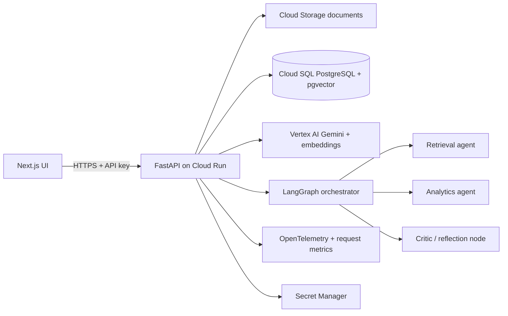

# FieldLens AI

**Enterprise AI Operations Workbench** — a deployable reference project for grounded enterprise search, governed analytics, and multi-agent workflow execution.

FieldLens ingests internal documents, retrieves relevant passages from PostgreSQL/pgvector, answers with citations using Gemini on Vertex AI, and routes complex requests through a LangGraph workflow. It includes a read-only NL-to-SQL path, approval-gated actions, request-level observability, evaluation scripts, and a Next.js interface.

> This is a portfolio-grade reference implementation. You must deploy it, run the evaluation suite, and collect your own measurements before making performance or production-readiness claims.

## Architecture



## Included capabilities

- **RAG:** document upload, text extraction for TXT/MD/PDF, chunking with overlap, Vertex AI embeddings, pgvector similarity retrieval, source citations.
- **Agentic workflows:** LangGraph routing, ReAct-style tool loop, task decomposition, specialist delegation, critic/reflection pass, bounded iteration count.
- **Analytics:** natural-language-to-SQL generation with strict read-only validation, table allowlist, row limit, and parameterised execution.
- **Governance:** API-key authentication, upload limits, file-type checks, prompt-injection-aware retrieval instructions, approval-gated action endpoint, SQL safety checks.
- **LLM operations:** request IDs, traces, latency, input/output tokens, estimated cost, tokens/second, structured logs, evaluation harness.
- **GCP:** Cloud Run, Cloud SQL, Cloud Storage, Vertex AI, Secret Manager, Artifact Registry, Cloud Build, IAM, Terraform.
- **Framework examples:** LangGraph is the primary runnable orchestrator. Optional adapter examples demonstrate CrewAI and Google ADK integration points; install and validate those separately before claiming hands-on use.
- **Frontend:** Next.js + TypeScript chat UI, document upload, source display, and request metrics.

## Quick start (local)

Requirements: Docker Desktop, Node.js 20+, Python 3.11+ (3.12 recommended), `uv` or pip.

1. Copy `.env.example` to `.env` and set `APP_API_KEY` to a long random value.
2. For live Gemini and embeddings, set `GOOGLE_CLOUD_PROJECT`, `GOOGLE_CLOUD_LOCATION`, and authenticate with Application Default Credentials (`gcloud auth application-default login`).
3. Start services:

```bash
docker compose up --build
```

API: http://localhost:8000/docs  
Frontend: http://localhost:3000  
Health: http://localhost:8000/health

For a deterministic local smoke test without Vertex AI, set `LLM_PROVIDER=mock` and `EMBEDDING_PROVIDER=mock`. Mock mode is for development/testing, not resume performance claims.

## API examples

```bash
export API_KEY='replace-me'
curl -H "X-API-Key: $API_KEY" http://localhost:8000/v1/health

curl -X POST http://localhost:8000/v1/documents \
  -H "X-API-Key: $API_KEY" \
  -F "file=@./samples/employee-handbook.md"

curl -X POST http://localhost:8000/v1/chat \
  -H "X-API-Key: $API_KEY" -H 'Content-Type: application/json' \
  -d '{"question":"What is the expense reimbursement policy?","mode":"auto"}'
```

## Evaluation and benchmarking

```bash
python -m pip install -e '.[dev]'
python scripts/evaluate.py --base-url http://localhost:8000 --api-key "$API_KEY"
python scripts/benchmark.py --base-url http://localhost:8000 --api-key "$API_KEY" --requests 30
```

The scripts write JSON reports to `artifacts/`. Record actual values only after a successful run. Cost is estimated from configurable model rates and is not a billing statement.

## GCP deployment

See [`infra/terraform/README.md`](infra/terraform/README.md). The Terraform stack provisions Cloud SQL, a GCS bucket, Artifact Registry, service account, and Cloud Run service. Vertex AI API and Secret Manager are enabled. You still need to configure billing, a project, region, and a database password secret.

High-level flow:

1. `gcloud auth login && gcloud config set project PROJECT_ID`
2. Create `fieldlens-db-password` in Secret Manager.
3. Configure `infra/terraform/terraform.tfvars`.
4. Apply Terraform.
5. Build and push the API image, then deploy using the generated Cloud Run service configuration.
6. Deploy the frontend to Cloud Run or Firebase App Hosting and set `NEXT_PUBLIC_API_URL` and `NEXT_PUBLIC_API_KEY` (for a public production app, replace this demo key flow with user identity/OIDC).

Do not expose a shared API key in a public browser deployment. The included key auth is suitable for a controlled demo; production should use Identity Platform / IAP / OIDC and per-user authorisation.

## Repository map

- `backend/` FastAPI service, RAG pipeline, LangGraph workflow, SQL guard, metrics.
- `frontend/` Next.js app.
- `adapters/` optional CrewAI and Google ADK examples.
- `infra/terraform/` GCP infrastructure.
- `scripts/` evaluation and load/latency benchmark.
- `samples/` sample knowledge base.
- `docs/` design, security, customer discovery, and deployment notes.

## Resume integrity checklist

Only list a technology as implemented after you have run its path. In particular, verify Vertex AI deployment, Cloud SQL pgvector, GCP IAM, CrewAI, Google ADK, tracing export, and benchmark numbers independently. The optional framework adapters are examples, not proof of production integration.
